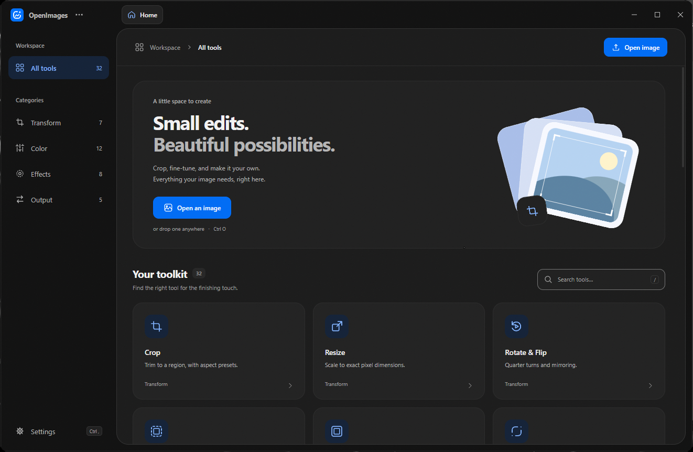
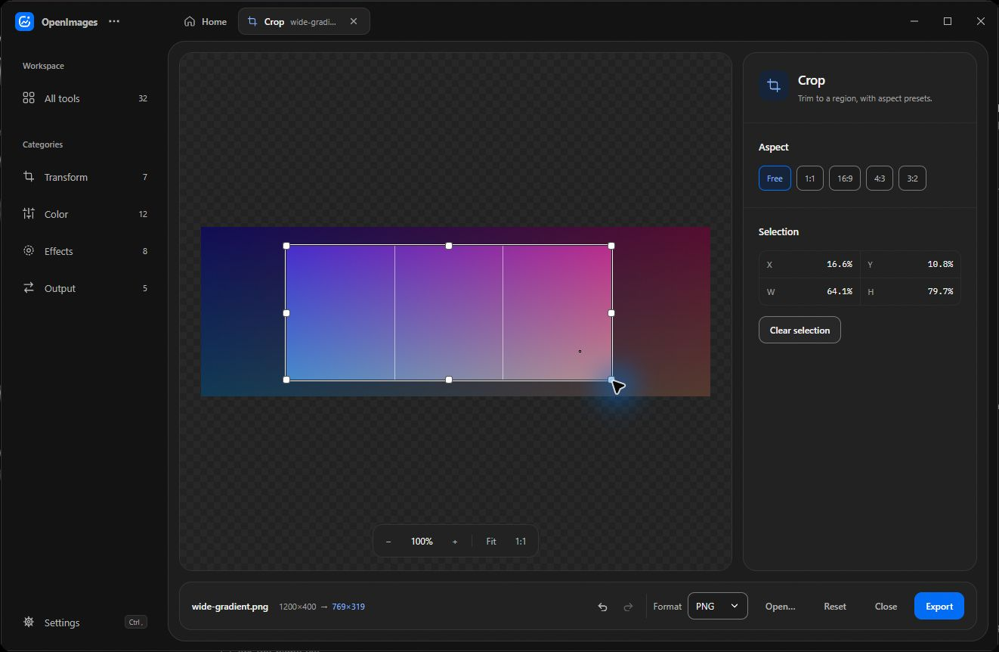

# OpenImages

OpenImages is a desktop editor for cropping, resizing, adjusting, and converting images. Edits and exports run locally.

[Download for Windows](https://github.com/M0-kii/OpenImages/releases/latest). Choose the x64 setup executable or MSI under Assets.



## Editing and export

- **Transform:** Crop, resize, rotate, flip, pad, and round corners.
- **Color:** Adjust exposure, levels, and temperature, or remove a flat background with Color Key.
- **Effects:** Blur, sharpen, pixelate, add grain, or emboss an image.
- **Output:** Export PNG, JPEG, WebP, BMP, TIFF, or ICO. Create favicon sets, extract a palette, or copy a data URI.



Open an image with `Ctrl+O` or drop it into the window. Tool tabs share the same image, edit history, and canvas view. Linked resize uses the dimensions of your crop. Use Undo and Redo in the export bar, or press `Ctrl+Z` and `Ctrl+Shift+Z` (or `Ctrl+Y`).

Before leaving an image with unfinished edits, choose **Export**, **Discard**, or **Cancel**. After an unexpected shutdown, OpenImages offers to restore the local edit draft using the original image file.

Open **Batch Export** from the tool library and drop in images or choose **Add images**. Pick a format and choose whether to keep the original size, fit each image within a size limit, or set exact dimensions. Save those settings as a preset to use again. You can also apply edits from the open image before resizing. The queue shows progress for each file and reports filename conflicts while keeping existing files intact.

## Run from source

Install Node.js, pnpm, Rust, and the [Tauri prerequisites](https://v2.tauri.app/start/prerequisites/) for your platform.

```sh
pnpm install
pnpm tauri dev
```

Run `pnpm tauri build` to package the app. Bundles are written to `src-tauri/target/release/bundle/`.

```sh
pnpm test
pnpm build
cargo test --locked --manifest-path src-tauri/Cargo.toml --lib
```

## How editing works

The React interface turns the current edits into an ordered list of operations. Rust previews those operations on a copy capped at 1600 pixels on its longest side, then applies them to the original pixels for export. Crop coordinates are relative to the image, which lets the same crop work across different input sizes in a batch.

Resize uses `fast_image_resize` with SIMD where supported. Lanczos3 remains the default; Nearest, Triangle (bilinear), and CatmullRom are also available. JPEG export composites transparency onto the matte color set in Settings.
